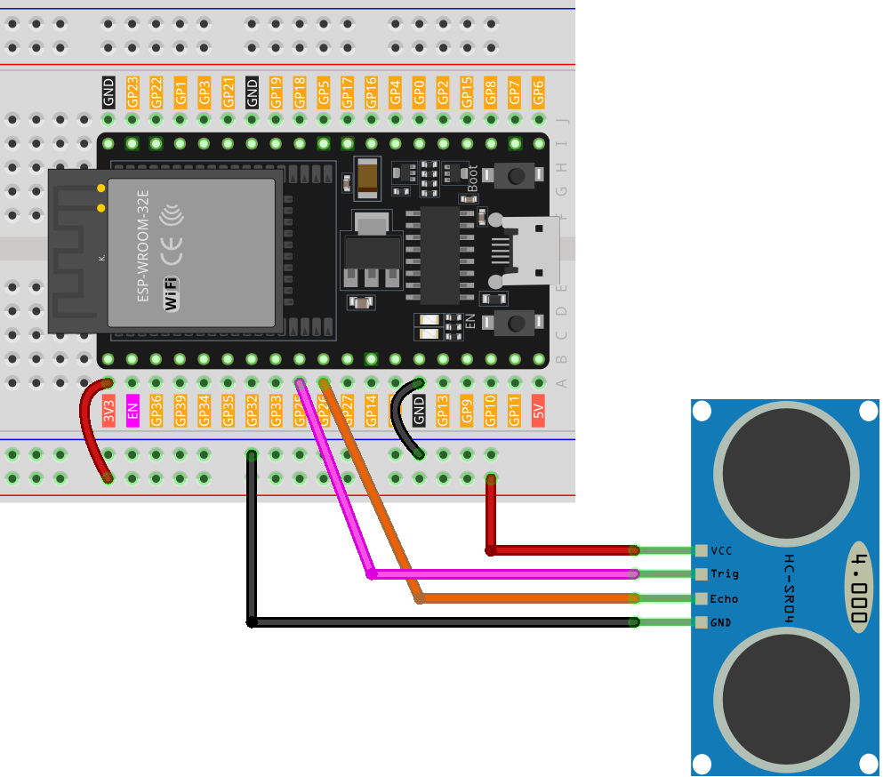

# Station: Ultraschallsensor und Serial Monitor

In dieser Station misst du mit einem HC-SR04-kompatiblen Ultraschallsensor den Abstand zu einem Gegenstand und gibst den Messwert im seriellen Monitor aus.

## Material und Aufbau

- ESP32-Dev-Board und USB-Kabel
- HC-SR04-kompatibler Ultraschallsensor
- Breadboard, Jumperkabel und zwei Widerstände (z. B. 1 kΩ und 2 kΩ) für den Echo-Spannungsteiler

Verdrahte den Sensor wie in der [Wiring-Darstellung von SunFounder](https://docs.sunfounder.com/projects/umsk/de/latest/03_esp32/esp32_lesson23_ultrasonic.html). TRIG ist mit **GPIO 25**, ECHO mit **GPIO 26** verbunden.

## Aufgabe

Lade das PlatformIO-Projekt auf den ESP32 und öffne den seriellen Monitor mit **9600 Baud**. Bewege einen Gegenstand vor dem Sensor und beobachte den Abstand in Zentimetern. Erkläre, warum die gemessene Echo-Zeit für den Hin- und Rückweg halbiert wird.

Messbereich und Genauigkeit hängen vom Sensor und vom Aufbau ab.
